# Спецификация требований к программному средству «HomeLedger — Домашняя бухгалтерия»

Версия 0.2 · Шаблон: `srs/srs-template.md` (по ISO/IEC/IEEE 29148:2018)

## История изменений

| Версия | Дата | Автор | Описание |
|---|---|---|---|
| 0.1 | [дата коммита v0.1] | Клещенок | Первая редакция по итогам интервью с Заказчиком: бизнес-цели, 15 функциональных требований, модели SysML v2 |
| 0.2 | [дата коммита v0.2] | Клещенок | Правки по замечаниям напарника (pull request): кошельки и переводы, измеримые правила советов, предупреждение о лимите сразу при вводе, подтверждение удаления, сравнение с прошлым месяцем. Изменены REQ-FUNC-006, 007, 011, 012; добавлены REQ-FUNC-016, 017, 018 |

---

## 1 Введение

### 1.1 Назначение документа

Документ описывает бизнес-требования, требования пользователей и требования к программному средству HomeLedger — приложению для ведения домашней бухгалтерии. Документ предназначен для Заказчика (напарник по паре, затем преподаватель), разработчика и тестировщика и служит основой для проектирования, реализации и приёмки на протяжении курса «Жизненный цикл разработки программного обеспечения».

### 1.2 Область применения и границы продукта

HomeLedger — настольное консольное приложение на C++17. Пользователь каждый раз отмечает в приложении свои доходы и расходы, а приложение показывает баланс, статистику и предлагает способы организации трат: месячные лимиты по категориям, правило 50/30/20, прогноз и дневной лимит.

**В рамках продукта:** учёт доходов, расходов и переводов между кошельками; категории и кошельки; журнал операций с исправлением и удалением; баланс; статистика и динамика; лимиты и предупреждения; советы по организации трат; экспорт отчёта в CSV; хранение данных в локальных файлах.

**Вне рамок (релиз 1):** графический интерфейс, мобильная и веб-версии, синхронизация с банками, несколько валют и курсы, регулярные (повторяющиеся) платежи, цели накоплений, многопользовательский доступ с паролями.

### 1.3 Определения, акронимы и сокращения

| Термин | Определение |
|---|---|
| Операция | Запись о движении денег: доход, расход или перевод |
| Доход | Поступление денег в кошелёк (зарплата, стипендия и т. п.) |
| Расход | Трата денег из кошелька по категории |
| Перевод | Перемещение денег между кошельками пользователя; не меняет общий баланс и не учитывается в доходах и расходах |
| Кошелёк | Место хранения денег: «Наличные», «Карта» и другие, заданные пользователем |
| Категория | Назначение дохода или расхода («Продукты», «Зарплата» и т. п.) |
| Группа категории | Необходимое, Желания или Сбережения — для правила 50/30/20 |
| Баланс | Сумма остатков всех кошельков |
| Остаток месяца | Доходы месяца минус расходы месяца |
| Лимит (бюджет) | Максимальная сумма расходов по категории за календарный месяц |
| Правило 50/30/20 | Распределение дохода: не более 50 % на необходимое, не более 30 % на желания, не менее 20 % в сбережения |
| Прогноз | Ожидаемые расходы за месяц = средний дневной расход × число дней месяца |
| Дневной лимит | Сумма, которую можно тратить в день до конца месяца, чтобы отложить 20 % дохода |
| Совет | Сообщение экрана «Советы», сформированное по одному из правил REQ-FUNC-012-2 |
| BYN | Белорусский рубль; единственная валюта релиза 1 |
| CSV | Текстовый табличный формат; в продукте — разделитель «;», кодировка UTF-8 |
| БЦ | Бизнес-цель |
| ВИ | Вариант использования |
| SRS | Software Requirements Specification — спецификация требований |
| SysML v2 | Язык системного моделирования, версия 2 |

### 1.4 Ссылки

1. ISO/IEC/IEEE 29148:2018. Systems and software engineering — Life cycle processes — Requirements engineering.
2. Вигерс К., Битти Д. Разработка требований к программному обеспечению. 3-е изд.
3. OMG Systems Modeling Language (SysML) v2.0 — https://www.omg.org/spec/SysML/2.0
4. RFC 4180. Common Format and MIME Type for CSV Files.
5. Модели SysML v2: каталог [models](models/), изображения: каталог [images](images/).

### 1.5 Обзор документа

Раздел 2 описывает продукт в целом, раздел 3 — требования, раздел 4 — способы их проверки, раздел 5 — приложения: прототип интерфейса на SysML v2, протокол интервью и замечания рецензентов.

---

## 2 Обзор продукта

### 2.1 Перспектива продукта

Сейчас Заказчик записывает траты в заметки телефона и время от времени бросает учёт; к концу месяца деньги заканчиваются, и непонятно, на что они ушли. HomeLedger — новый самостоятельный продукт, который заменяет такие записи. Бизнес-цели Заказчика показаны на рисунке 1.

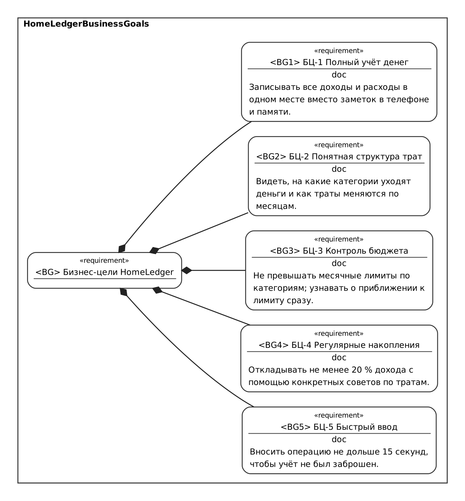

*Рисунок 1 — Бизнес-цели (модель [models/03-business-goals.sysml](models/03-business-goals.sysml))*

| ID | Бизнес-цель | Измеримый показатель |
|---|---|---|
| БЦ-1 | Полный учёт денег | Все операции хранятся в одной программе; баланс в программе совпадает с фактическим |
| БЦ-2 | Понятная структура трат | Распределение расходов месяца по категориям и динамика за 6 месяцев на одном экране |
| БЦ-3 | Контроль бюджета | Предупреждение при достижении 80 % и превышении 100 % лимита в момент ввода расхода |
| БЦ-4 | Регулярные накопления | Не менее 20 % дохода месяца откладывается (группа «Сбережения» + остаток месяца) |
| БЦ-5 | Быстрый ввод | Ввод операции занимает не более 15 с |

Системный контекст продукта приведён на рисунке 2. Приложение не взаимодействует с банками и сетью; данные хранятся в CSV-файлах каталога данных, отчёты открываются в табличном редакторе.

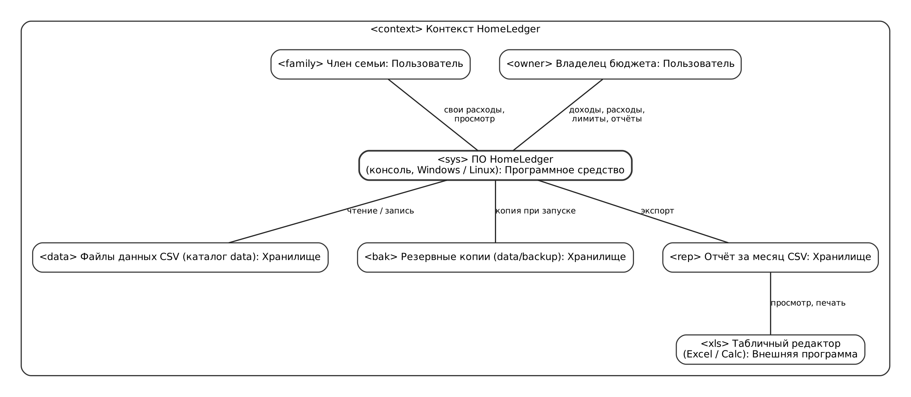

*Рисунок 2 — Системный контекст HomeLedger (модель [models/01-context.sysml](models/01-context.sysml))*

### 2.2 Функции продукта

Варианты использования показаны на рисунке 3.

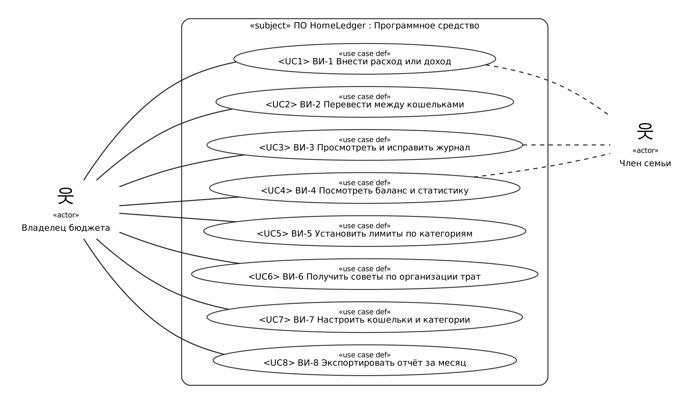

*Рисунок 3 — Варианты использования (модель [models/02-usecases.sysml](models/02-usecases.sysml))*

| ВИ | Название | Требования |
|---|---|---|
| ВИ-1 | Внести расход или доход | REQ-FUNC-001, 002, 003, 018 |
| ВИ-2 | Перевести между кошельками | REQ-FUNC-017 |
| ВИ-3 | Просмотреть и исправить журнал | REQ-FUNC-004, 005, 006-2 |
| ВИ-4 | Посмотреть баланс и статистику | REQ-FUNC-007-2, 008, 009 |
| ВИ-5 | Установить лимиты по категориям | REQ-FUNC-010, 011-2 |
| ВИ-6 | Получить советы по организации трат | REQ-FUNC-012-2 |
| ВИ-7 | Настроить кошельки и категории | REQ-FUNC-013, 016 |
| ВИ-8 | Экспортировать отчёт за месяц | REQ-FUNC-014 |

### 2.3 Ограничения продукта

| ID | Ограничение | Источник |
|---|---|---|
| CON-1 | Приложение работает без подключения к Интернету и не использует внешние сервисы | Заказчик (интервью, вопрос 9) |
| CON-2 | Язык разработки — C++17, только стандартная библиотека; сборка CMake | Задание варианта, курс ЖЦРПО |
| CON-3 | Интерфейс — текстовый (консоль) в Windows 10/11; дополнительно — Linux | Решение по проекту, раздел 2.6 |
| CON-4 | Данные хранятся в CSV-файлах (UTF-8) в каталоге данных; СУБД не используется | Простота переноса и резервирования |
| CON-5 | Одна валюта — BYN | Заказчик |
| CON-6 | Срок — семестр, разработчик — один студент | Учебный процесс |

### 2.4 Пользователи

| Класс пользователей | Кто | Задачи | Частота работы |
|---|---|---|---|
| Владелец бюджета (основной) | Студент или член молодой семьи, ведущий личный бюджет; базовые навыки работы с ПК | Все функции: ввод, лимиты, советы, кошельки, отчёты | Ежедневно, 1–5 операций |
| Член семьи | Человек, который пользуется тем же домашним компьютером | Ввод своих расходов, просмотр баланса и статистики | Несколько раз в неделю |

Технически роли не разграничиваются (REQ-SEC-002): оба класса пользователей работают с одним каталогом данных.

### 2.5 Допущения и зависимости

- У пользователя есть компьютер с Windows 10/11 (или Linux) и консолью с поддержкой UTF-8 (Windows Terminal или стандартная консоль).
- Пользователь вводит операции добросовестно; сверка с банковской выпиской выполняется вручную.
- Шрифт консоли содержит символы псевдографики «█», «░», «─» (Consolas, Cascadia Mono и др.).
- Для открытия отчёта установлен табличный редактор (Microsoft Excel или LibreOffice Calc).

### 2.6 Распределение требований по релизам

| Релиз | Состав |
|---|---|
| Релиз 1 (курс ЖЦРПО, консольная версия) | Все требования раздела 3 |
| Релиз 2 (отложено) | Графический интерфейс (Qt 6) на основе библиотеки логики ledger_core (REQ-REUSE-001); импорт CSV-выписки банка (замечание З-6); несколько валют с курсами НБ РБ (замечание З-8); регулярные платежи; цели накоплений |
| Не планируется | Мобильное и веб-приложение (замечание З-7) |

---

## 3 Требования

Каждое требование имеет идентификатор вида `REQ-[ОБЛАСТЬ]-[NNN]-[версия]`. Суффикс версии добавляется к требованию, изменённому после рецензирования; новые требования получают следующий свободный номер.

### 3.1 Внешние интерфейсы

#### REQ-INT-001 Текстовое меню
- **Statement:** Система должна предоставлять главное меню из пунктов 1–9 и 0 (выход); пункт выбирается вводом цифры и клавишей Enter.
- **Rationale:** Простой интерфейс без обучения (БЦ-5, CON-3).
- **Acceptance Criteria:** Ввод номера открывает соответствующий экран; ввод несуществующего номера выводит «Нет такого пункта меню» и снова показывает меню.
- **Verification Method:** Demonstration
- **More Information:** Мокап — рисунок 7, карта экранов — рисунок 6.

#### REQ-INT-002 Кириллица в консоли
- **Statement:** Система должна корректно выводить и принимать русский текст в консоли Windows и Linux.
- **Rationale:** Названия категорий и комментарии вводятся по-русски.
- **Acceptance Criteria:** Комментарий «хлеб, молоко» сохраняется в файл и выводится в журнале без искажений.
- **Verification Method:** Test

#### REQ-INT-003 Выделение и обозначения
- **Statement:** Система должна выделять доходы зелёным цветом и знаком «+», расходы — красным и знаком «−», предупреждения — жёлтым или красным с отметкой «[!]»; цвет отключается параметром `--no-color`.
- **Rationale:** Информация не должна передаваться только цветом (доступность, вывод в файл).
- **Acceptance Criteria:** При `--no-color` в выводе нет управляющих последовательностей, отметки и знаки сохраняются.
- **Verification Method:** Inspection

#### REQ-INT-004 Формат дат и сумм
- **Statement:** Система должна показывать даты в формате ДД.ММ.ГГГГ, суммы — с разделителем тысяч и двумя знаками после запятой («1 234,56»); принимать даты в форматах ДД.ММ.ГГГГ, ДД.ММ, ГГГГ-ММ-ДД, суммы — с запятой или точкой.
- **Rationale:** Привычный для пользователя формат.
- **Acceptance Criteria:** Ввод «12,5» и «12.50» даёт сумму 12,50; ввод «12,345» отклоняется.
- **Verification Method:** Test

#### REQ-INT-005 Файлы данных
- **Statement:** Система должна хранить данные в каталоге данных в файлах operations.csv, categories.csv, wallets.csv, budgets.csv (UTF-8, разделитель «;», первая строка — заголовок, значения с «;» или кавычками заключаются в кавычки).
- **Rationale:** Данные можно открыть, проверить и перенести без программы (CON-4).
- **Acceptance Criteria:** Файлы открываются текстовым редактором; комментарий с «;» и кавычками восстанавливается после перезапуска.
- **Verification Method:** Test

#### REQ-INT-006 Отчёт для табличного редактора
- **Statement:** Система должна формировать отчёт в формате CSV, который открывается в Excel с русской локалью без мастера импорта: UTF-8 с BOM, разделитель «;», десятичная запятая.
- **Rationale:** Заказчик показывает итоги месяца семье в Excel (интервью, вопрос 10).
- **Acceptance Criteria:** Двойной щелчок по файлу открывает его в Excel; числа распознаются как числа, кириллица читается.
- **Verification Method:** Demonstration

#### REQ-INT-007 Параметры командной строки
- **Statement:** Система должна поддерживать параметры `--data КАТАЛОГ`, `--demo`, `--no-color`, `--help`, `--version`.
- **Rationale:** Отдельные каталоги данных для разных пользователей и демонстрации.
- **Acceptance Criteria:** `--help` выводит справку и завершает работу с кодом 0; неизвестный параметр — справку и код 1.
- **Verification Method:** Test

### 3.2 Функциональные требования

#### REQ-FUNC-001 Ввод расхода
- **Statement:** Система должна регистрировать расход: сумма, категория расходов, кошелёк, дата, комментарий (необязательно).
- **Rationale:** Основная функция учёта (БЦ-1).
- **Acceptance Criteria:** После сохранения выводится номер операции, сумма, категория, кошелёк и новый баланс; операция появляется в журнале и файле. Пустая сумма отменяет ввод.
- **Verification Method:** Test
- **More Information:** Сценарий — рисунок 5, мокап — рисунок 8.

#### REQ-FUNC-002 Ввод дохода
- **Statement:** Система должна регистрировать доход с теми же полями, что и расход, с выбором из категорий доходов.
- **Rationale:** БЦ-1.
- **Acceptance Criteria:** Доход увеличивает остаток выбранного кошелька и доходы месяца.
- **Verification Method:** Test

#### REQ-FUNC-003 Проверка вводимых данных
- **Statement:** Система должна отклонять операцию, если сумма не больше 0 или больше 100 000 000 BYN, содержит больше двух знаков после запятой, дата позже текущей, категория или кошелёк не существуют, комментарий длиннее 100 символов.
- **Rationale:** Достоверность учёта (БЦ-1).
- **Acceptance Criteria:** При ошибке выводится причина, операция не сохраняется, ввод повторяется.
- **Verification Method:** Test

#### REQ-FUNC-004 Журнал операций
- **Statement:** Система должна показывать операции выбранного месяца в порядке дат (№, дата, тип, категория, кошелёк, сумма, комментарий), итоги месяца, переход к предыдущему и следующему месяцу и фильтр по категории.
- **Rationale:** Проверка и поиск записей (БЦ-1).
- **Acceptance Criteria:** Команды «<» и «>» меняют месяц; фильтр «к» оставляет операции одной категории; итоги пересчитываются.
- **Verification Method:** Demonstration
- **More Information:** Мокап — рисунок 9.

#### REQ-FUNC-005 Изменение операции
- **Statement:** Система должна позволять изменить сумму, категорию, кошелёк, дату и комментарий операции по её номеру; пустой ввод сохраняет прежнее значение.
- **Rationale:** Исправление ошибок ввода.
- **Acceptance Criteria:** Изменённые данные проходят проверки REQ-FUNC-003 и сохраняются в файл.
- **Verification Method:** Test

#### REQ-FUNC-006-2 Удаление операции с подтверждением
- **Statement:** Система должна удалять операцию по номеру только после подтверждения («д»), показав тип, сумму, дату и категорию удаляемой операции.
- **Rationale:** Защита от случайного удаления (замечание З-4).
- **Acceptance Criteria:** Ответ, отличный от «д»/«да», отменяет удаление.
- **Verification Method:** Test
- **More Information:** Версия 1 удаляла операцию без подтверждения.

#### REQ-FUNC-007-2 Баланс по кошелькам
- **Statement:** Система должна показывать на главном экране общий баланс, остаток каждого кошелька, а также доходы, расходы и остаток текущего месяца.
- **Rationale:** БЦ-1; раздельный учёт наличных и карты (замечание З-1).
- **Acceptance Criteria:** Остаток кошелька = начальный остаток + доходы − расходы ± переводы; общий баланс = сумма остатков.
- **Verification Method:** Test
- **More Information:** Версия 1 показывала только общий баланс.

#### REQ-FUNC-008 Статистика за месяц
- **Statement:** Система должна показывать за выбранный месяц доходы, расходы, остаток, число операций, расходы и доходы по категориям (сумма, доля в %, полоса-диаграмма) по убыванию суммы и структуру расходов по группам 50/30/20 в процентах от дохода.
- **Rationale:** БЦ-2.
- **Acceptance Criteria:** Сумма по категориям равна итогу; переводы не учитываются.
- **Verification Method:** Test
- **More Information:** Мокап — рисунок 10.

#### REQ-FUNC-009 Динамика
- **Statement:** Система должна показывать доходы и расходы за 6 месяцев, заканчивая выбранным, с полосами в едином масштабе.
- **Rationale:** БЦ-2.
- **Acceptance Criteria:** Отображаются 6 строк; месяцы без операций показываются с нулями.
- **Verification Method:** Demonstration

#### REQ-FUNC-010 Месячные лимиты
- **Statement:** Система должна позволять установить, изменить и снять месячный лимит для категории расходов и показывать по каждому лимиту: лимит, потрачено, осталось, процент использования.
- **Rationale:** БЦ-3.
- **Acceptance Criteria:** Лимит действует на каждый календарный месяц; перед вводом лимита выводится сумма, уже потраченная в этом месяце.
- **Verification Method:** Test
- **More Information:** Мокап — рисунок 11, состояния лимита — рисунок 4.

#### REQ-FUNC-011-2 Предупреждение о лимите
- **Statement:** Система должна сразу после сохранения расхода выводить состояние лимита его категории, а на главном экране — список лимитов в состояниях «Почти исчерпан» (использовано не менее 80 %) и «Превышен» (более 100 %).
- **Rationale:** О превышении нужно узнавать в момент траты, а не в конце месяца (БЦ-3, замечание З-3).
- **Acceptance Criteria:** При лимите 150,00 и расходах 120,00 выводится «использовано 80 %»; при расходах 150,01 — «превышен».
- **Verification Method:** Test
- **More Information:** Версия 1 показывала превышение только на экране «Бюджеты».

#### REQ-FUNC-012-2 Советы по организации трат
- **Statement:** Система должна формировать советы для текущего месяца по правилам: (1) 50/30/20 — сравнение долей групп с нормами 50/30/20 %; (2) прогноз расходов на месяц и предупреждение, если прогноз больше доходов; (3) дневной лимит до конца месяца при откладывании 20 % дохода; (4) три самые затратные категории с долями; (5) рост расходов по категории более чем на 20 % (и не менее 20 BYN) по сравнению с прошлым месяцем; (6) лимиты в состояниях «Почти исчерпан» и «Превышен», а при отсутствии лимитов — предложение лимита для самой затратной категории; (7) отсутствие доходов в месяце.
- **Rationale:** Способы организации трат из задания варианта (БЦ-4); правила должны быть проверяемыми (замечания З-2, З-5).
- **Acceptance Criteria:** Каждый совет имеет отметку [+] (норма выполнена), [i] (информация) или [!] (нарушение) и содержит числа, на основании которых он сделан.
- **Verification Method:** Test
- **More Information:** Мокап — рисунок 12. Версия 1: «система должна давать советы по экономии».

#### REQ-FUNC-013 Категории
- **Statement:** Система должна при первом запуске создавать стандартные категории расходов (Продукты, Жильё и ЖКУ, Транспорт, Связь и интернет, Здоровье — необходимое; Кафе и рестораны, Развлечения, Одежда, Подарки, Прочее — желания; Сбережения) и доходов (Зарплата, Стипендия, Подработка, Подарки, Прочие доходы) и позволять добавлять свои с указанием группы.
- **Rationale:** Быстрый старт и гибкость (БЦ-2, БЦ-5).
- **Acceptance Criteria:** Повторное название в одном типе не добавляется.
- **Verification Method:** Test

#### REQ-FUNC-014 Экспорт отчёта
- **Statement:** Система должна сохранять отчёт за выбранный месяц в файл report_ГГГГ-ММ.csv: итоги, расходы по категориям с долями и лимитами, список операций.
- **Rationale:** Показ итогов семье (БЦ-2).
- **Acceptance Criteria:** После экспорта выводится путь к файлу; формат — REQ-INT-006.
- **Verification Method:** Demonstration

#### REQ-FUNC-015 Демонстрационные данные
- **Statement:** Система должна по параметру `--demo` заполнять пустой каталог данных операциями за 6 месяцев и тремя лимитами.
- **Rationale:** Демонстрация Заказчику и преподавателю без ручного ввода.
- **Acceptance Criteria:** Если операции уже есть, данные не изменяются и выводится сообщение.
- **Verification Method:** Demonstration

#### REQ-FUNC-016 Кошельки
- **Statement:** Система должна создавать кошельки «Наличные» и «Карта» и позволять добавлять кошельки с начальным остатком; у каждой операции указывается кошелёк.
- **Rationale:** Раздельный учёт наличных и безналичных денег (замечание З-1).
- **Acceptance Criteria:** Добавленный кошелёк появляется в списках выбора и на главном экране.
- **Verification Method:** Test

#### REQ-FUNC-017 Перевод между кошельками
- **Statement:** Система должна регистрировать перевод суммы из одного кошелька в другой (снятие наличных, пополнение копилки) без изменения общего баланса, доходов и расходов.
- **Rationale:** Замечание З-1.
- **Acceptance Criteria:** Перевод в тот же кошелёк отклоняется; в журнале перевод отображается как «→ кошелёк назначения».
- **Verification Method:** Test

#### REQ-FUNC-018 Расход больше остатка
- **Statement:** Система должна предупреждать, если сумма расхода больше остатка кошелька, и сохранять расход только после подтверждения.
- **Rationale:** Ошибка в выборе кошелька или забытая операция (замечание З-1).
- **Acceptance Criteria:** Без подтверждения операция не сохраняется.
- **Verification Method:** Test

### 3.3 Качество обслуживания

#### 3.3.1 Производительность

| ID | Требование | Критерий приёмки | Метод |
|---|---|---|---|
| REQ-PERF-001 | Ввод расхода со значениями по умолчанию требует не более 6 действий (сумма, категория, 4 × Enter) | Опытный пользователь вводит операцию не дольше 15 с (БЦ-5) | Demonstration |
| REQ-PERF-002 | Любой экран выводится не дольше 1 с при 10 000 операциях | Замер на ПК с процессором не ниже 2 ГГц | Test |
| REQ-PERF-003 | Запуск с загрузкой 10 000 операций — не дольше 2 с | Замер времени до появления меню | Test |

#### 3.3.2 Безопасность

| ID | Требование | Критерий приёмки | Метод |
|---|---|---|---|
| REQ-SEC-001 | Данные хранятся только локально; программа не выполняет сетевых соединений | В коде нет сетевых вызовов; работа без сети полностью функциональна | Inspection |
| REQ-SEC-002 | Доступ к данным ограничивается правами учётной записи ОС на каталог данных; собственной авторизации нет | Документировано в README | Inspection |
| REQ-SEC-003 | Программа не запрашивает и не хранит номера карт, счета, пароли и другие банковские реквизиты | Нет таких полей ввода и данных в файлах | Inspection |

#### 3.3.3 Надёжность

| ID | Требование | Критерий приёмки | Метод |
|---|---|---|---|
| REQ-REL-001 | Каждое изменение данных сохраняется в файл сразу | После закрытия окна консоли изменения не теряются | Test |
| REQ-REL-002 | Запись выполняется через временный файл с последующей заменой | При сбое записи прежний файл остаётся целым | Inspection |
| REQ-REL-003 | При запуске создаётся резервная копия файлов в каталоге data/backup | Файлы *.bak появляются после запуска | Test |
| REQ-REL-004 | Повреждённые строки файлов пропускаются с предупреждением, остальные данные загружаются | Тест с испорченной строкой | Test |
| REQ-REL-005 | Суммы хранятся и вычисляются в целых копейках | Сумма 0,10 + 0,20 даёт ровно 0,30 | Test |

#### 3.3.4 Доступность

| ID | Требование | Критерий приёмки | Метод |
|---|---|---|---|
| REQ-AVAIL-001 | Все функции доступны без подключения к сети (CON-1) | Проверка при отключённой сети | Demonstration |

#### 3.3.5 Наблюдаемость

| ID | Требование | Критерий приёмки | Метод |
|---|---|---|---|
| REQ-OBS-001 | Сообщения об ошибках выводятся по-русски с причиной и способом исправления | Например: «Введите дату в формате ДД.ММ.ГГГГ, не позже сегодняшней» | Inspection |

### 3.4 Соответствие стандартам

| ID | Требование | Критерий приёмки | Метод |
|---|---|---|---|
| REQ-COMP-001 | Файлы CSV соответствуют RFC 4180 (кавычки и экранирование) с разделителем «;» | Тест разбора строки с «;» и кавычками | Test |
| REQ-COMP-002 | Исходный код соответствует стандарту ISO C++17 и компилируется MSVC 2019+, MinGW-w64 (GCC 9+), GCC/Clang в Linux без предупреждений при -Wall -Wextra | Сборка в CI или вручную | Test |

### 3.5 Проектирование и реализация

| ID | Требование | Критерий приёмки | Метод |
|---|---|---|---|
| REQ-INST-001 | Установка не требуется: один исполняемый файл; каталог данных создаётся при первом запуске | Запуск на чистом ПК | Demonstration |
| REQ-BUILD-001 | Сборка — CMake 3.16+, цели HomeLedger и ledger_tests | `cmake -B build && cmake --build build` | Test |
| REQ-DIST-001 | Распространение — архив с исполняемым файлом и README | Архив в релизе репозитория | Inspection |
| REQ-MAINT-001 | Логика (модель, статистика, хранение) отделена от консольного интерфейса и покрыта модульными тестами | ledger_tests проходит без ошибок | Test |
| REQ-REUSE-001 | Библиотека ledger_core не зависит от консоли и пригодна для GUI релиза 2 | В ledger_core нет ввода-вывода в консоль | Inspection |
| REQ-PORT-001 | Поддерживаемые ОС — Windows 10/11 и Linux | Запуск в обеих ОС | Demonstration |
| REQ-COST-001 | Используются только бесплатные инструменты и библиотеки | Перечень в README | Inspection |
| REQ-DEAD-001 | SRS v0.2 — к защите ЛР № 3; рабочая версия — до конца семестра | Даты коммитов | Inspection |
| REQ-POC-001 | Консольный прототип v0.2.0 демонстрирует REQ-FUNC-001…018 | Демонстрация Заказчику | Demonstration |
| REQ-CM-001 | Исходный код и документы хранятся в Git; изменения — в отдельных ветках через pull request; версии — по SemVer | История ветки lab3 | Inspection |

### 3.6 Искусственный интеллект и машинное обучение

Неприменимо: советы формируются по детерминированным правилам REQ-FUNC-012-2.

---

## 4 Верификация

| Требование | Метод | Артефакт проверки | Статус |
|---|---|---|---|
| REQ-INT-001…003 | Demonstration / Inspection | Скриншоты главного экрана, запуск с `--no-color` | Выполнено (v0.2.0) |
| REQ-INT-004, 005, 007 | Test | tests/tests.cpp: testMoney, testDate, testStorage | Выполнено |
| REQ-INT-006, REQ-FUNC-014 | Demonstration | Файл report_ГГГГ-ММ.csv в Excel | Выполнено |
| REQ-FUNC-001…003, 005, 016…018 | Test | testLedger; ручной сценарий ввода | Выполнено |
| REQ-FUNC-004, 006-2 | Demonstration / Test | Экран журнала, подтверждение удаления | Выполнено |
| REQ-FUNC-007-2…009 | Test | testLedger (баланс, статистика) | Выполнено |
| REQ-FUNC-010, 011-2 | Test | testLedger (состояния Near/Over) | Выполнено |
| REQ-FUNC-012-2 | Test | testLedger (makeAdvice), экран «Советы» | Выполнено |
| REQ-FUNC-013, 015 | Test / Demonstration | Первый запуск, `--demo` | Выполнено |
| REQ-PERF-001…003 | Demonstration / Test | Замер на 10 000 операций: запуск и вывод экранов — 0,02 с (Linux, GCC 13) | Выполнено |
| REQ-SEC-001…003 | Inspection | Обзор кода | Выполнено |
| REQ-REL-001…005 | Test / Inspection | testStorage, тест с повреждённым файлом | Выполнено |
| REQ-AVAIL-001, REQ-OBS-001 | Demonstration / Inspection | Работа без сети, тексты ошибок | Выполнено |
| REQ-COMP-001, 002 | Test | testText; сборка GCC 13 и Clang без предупреждений; MSVC и MinGW | GCC, Clang — выполнено; MSVC, MinGW — запланировано |
| REQ-INST-001…REQ-CM-001 | Inspection / Demonstration | README, CMakeLists.txt, история Git | Выполнено |

---

## 5 Приложения

### 5.1 Модели SysML v2 и прототип интерфейса

Модели хранятся в каталоге [models](models/) в текстовой нотации SysML v2; изображения — в каталоге [images](images/) (строятся скриптом [models/render.py](models/render.py)).

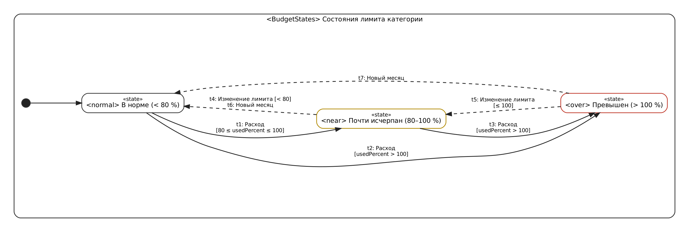

*Рисунок 4 — Состояния лимита категории ([models/04-budget-states.sysml](models/04-budget-states.sysml))*

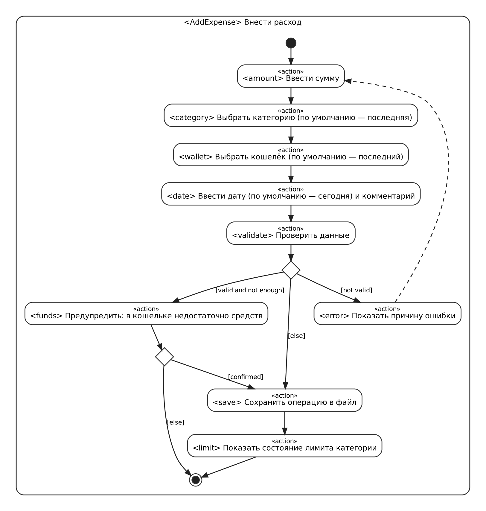

*Рисунок 5 — Сценарий «Внести расход» ([models/05-add-expense.sysml](models/05-add-expense.sysml))*

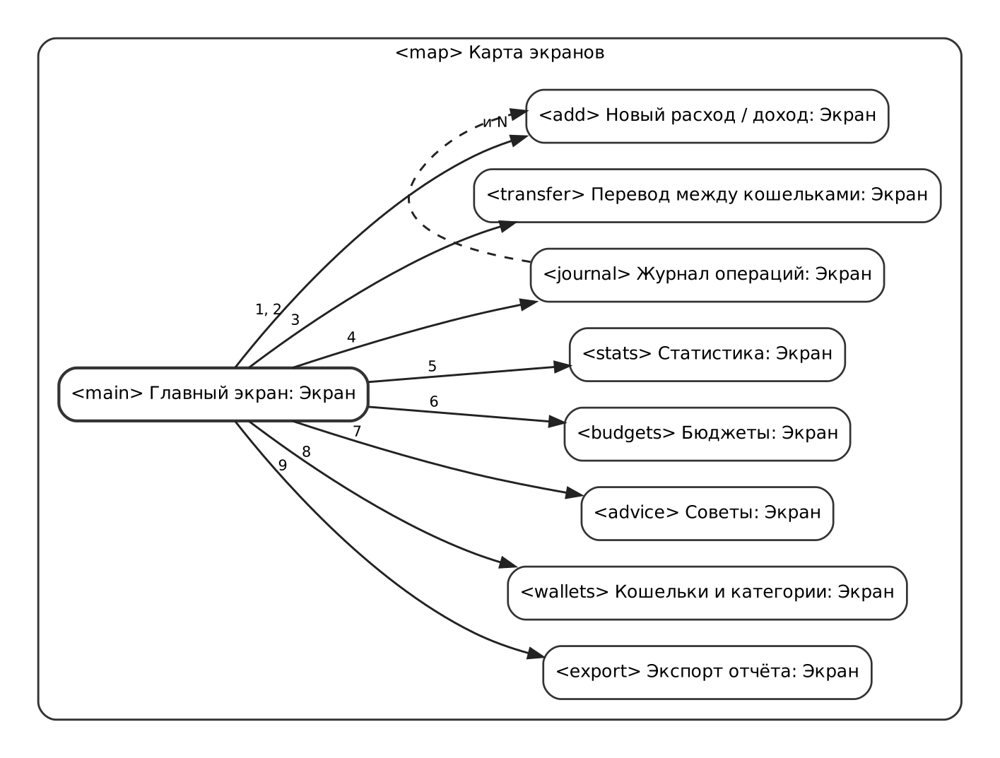

*Рисунок 6 — Карта экранов ([models/06-ui.sysml](models/06-ui.sysml))*

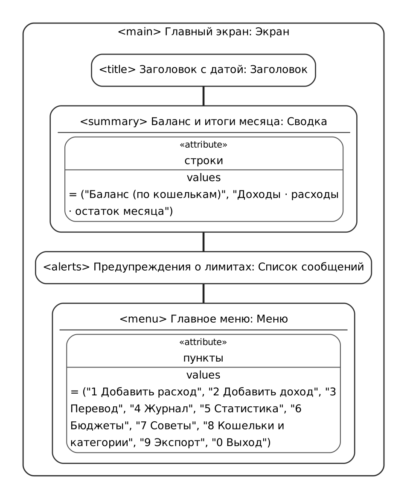

*Рисунок 7 — Мокап главного экрана*

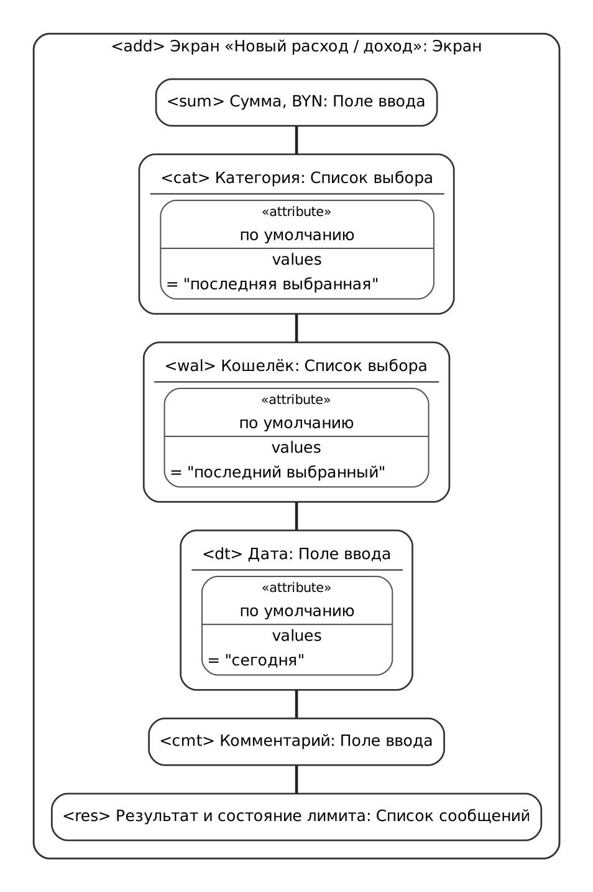

*Рисунок 8 — Мокап экрана «Новый расход / доход»*

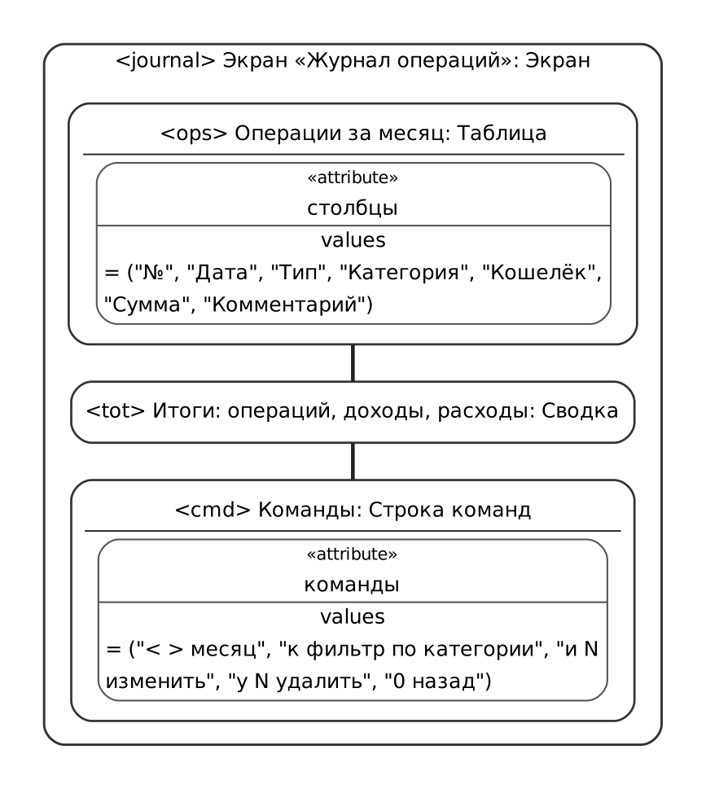

*Рисунок 9 — Мокап экрана «Журнал операций»*

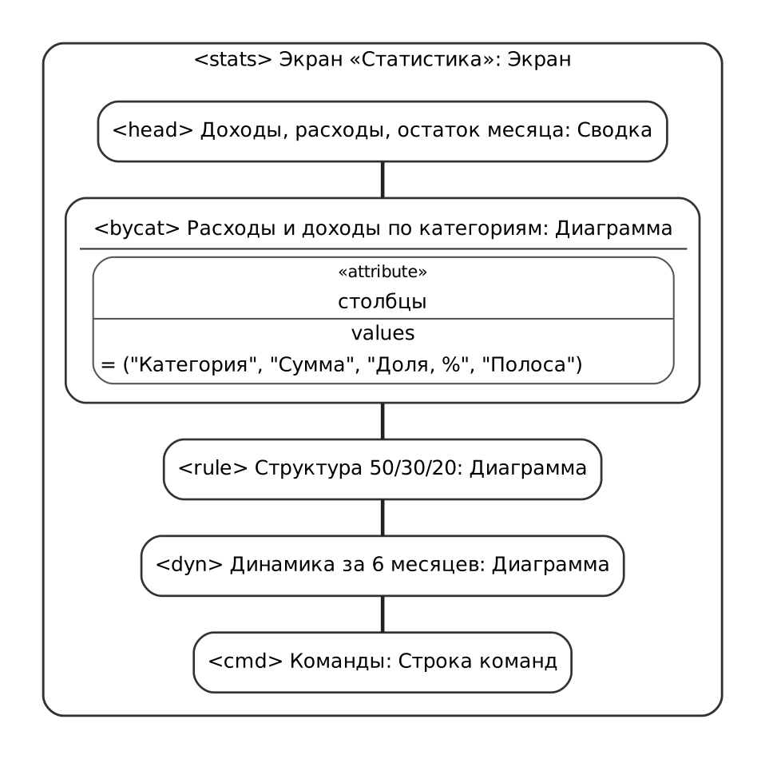

*Рисунок 10 — Мокап экрана «Статистика»*

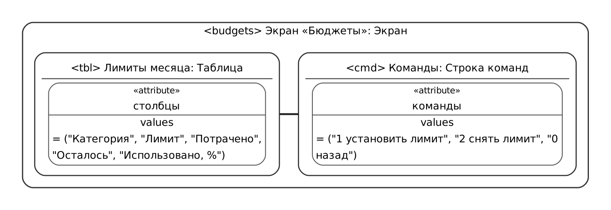

*Рисунок 11 — Мокап экрана «Бюджеты»*

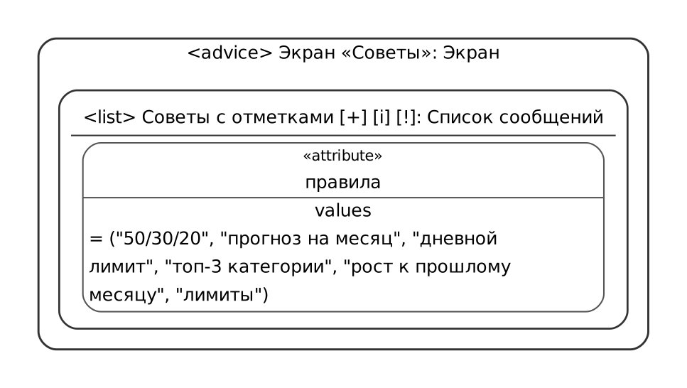

*Рисунок 12 — Мокап экрана «Советы»*

### 5.2 Протокол интервью с Заказчиком

| № | Вопрос Менеджера | Ответ Заказчика | Результат |
|---|---|---|---|
| 1 | Какую проблему должно решить ПО? | Деньги «утекают»: к концу месяца их не хватает и непонятно, на что потрачены. Записи в заметках телефона быстро забрасываются | БЦ-1, БЦ-2 |
| 2 | Кто будет пользоваться программой? | Я и члены семьи на одном домашнем компьютере; пароль не нужен | Классы пользователей, REQ-SEC-002 |
| 3 | Что нужно записывать? | Доходы и расходы: сумма, на что, когда, короткий комментарий | REQ-FUNC-001…003 |
| 4 | Какие нужны категории? | Обычные — продукты, транспорт, кафе… — плюс возможность добавить свои | REQ-FUNC-013 |
| 5 | Что важно видеть? | Сколько денег сейчас, на что уходит больше всего, как меняется по месяцам | REQ-FUNC-007, 008, 009 |
| 6 | Как вы хотите контролировать траты? | Ставить лимит на месяц на кафе, развлечения, продукты | БЦ-3, REQ-FUNC-010, 011 |
| 7 | Что значит «способы организации трат»? | Подсказки, сколько можно тратить и сколько откладывать; слышал про правило 50/30/20 | БЦ-4, REQ-FUNC-012 |
| 8 | Сколько времени готовы тратить на одну запись? | Не больше 10–15 секунд, иначе брошу | БЦ-5, REQ-PERF-001 |
| 9 | Нужен ли Интернет или телефон? | Нет, хватит компьютера; данные не должны уходить в сеть | CON-1, REQ-SEC-001 |
| 10 | Нужны ли отчёты? | Иногда показать семье итоги месяца в Excel | REQ-FUNC-014, REQ-INT-006 |

### 5.3 Замечания рецензентов и решения

Замечания напарника (Заказчика) к версии 0.1, полученные в pull request:

| № | Замечание | Решение | Обоснование и изменение |
|---|---|---|---|
| З-1 | Наличные и карту нужно учитывать отдельно, иначе баланс не сходится | Принято | Добавлены кошельки REQ-FUNC-016, переводы REQ-FUNC-017, предупреждение REQ-FUNC-018; изменено REQ-FUNC-007-2 |
| З-2 | Требование «давать советы по экономии» нельзя проверить | Принято | Перечислены правила с порогами (REQ-FUNC-012-2) |
| З-3 | О превышении лимита я узнаю только в конце месяца | Принято | Предупреждение сразу после ввода расхода, порог 80 % (REQ-FUNC-011-2) |
| З-4 | Операцию можно удалить случайно | Принято | Подтверждение удаления (REQ-FUNC-006-2) |
| З-5 | Хочу видеть, где траты выросли по сравнению с прошлым месяцем | Принято | Правило роста > 20 % в REQ-FUNC-012-2 |
| З-6 | Загружать операции из интернет-банка автоматически | Отклонено, отложено | Нужен Интернет (CON-1); единого открытого API банков нет. Импорт CSV-выписки — релиз 2 (2.6) |
| З-7 | Сделать мобильное приложение | Отклонено | Противоречит CON-2, CON-3 и сроку CON-6 |
| З-8 | Учитывать доллары и евро с пересчётом по курсу | Отклонено, отложено | Курсы требуют Интернет (CON-1), CON-5. Перенесено в релиз 2 (2.6) |

Замечания преподавателя: [вносятся после рецензирования].
