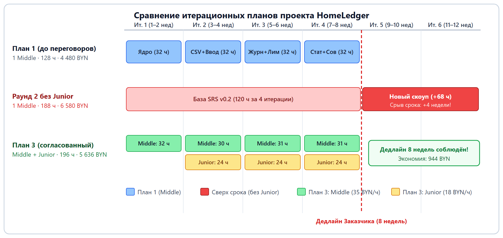
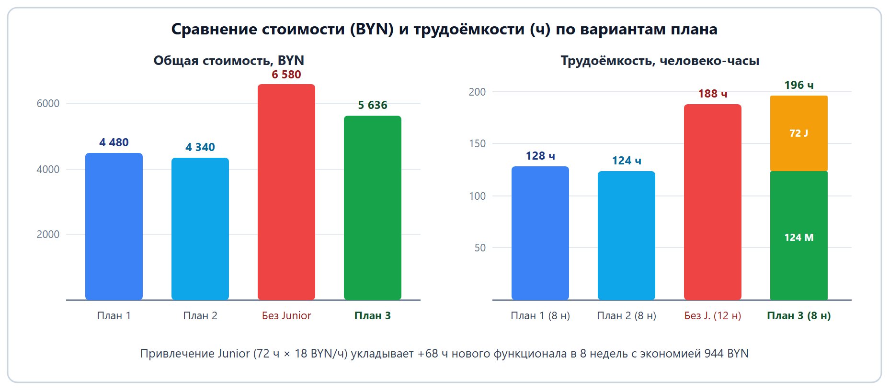

# Приоритезация функционала, переговоры с Заказчиком и план итераций (ЛР № 4)

## 1. Приоритизация системного функционала (от 10 — наивысший до 50 — минимальный)

| Feature ID | Feature Name (English) | Описание функционала (RU) | Требования SRS | Первичный приоритет | Итоговый приоритет |
|---|---|---|---|---|---|
| F-01 | Core Data Types & Integer Money Engine | Точные типы дат, денег в копейках, UTF-8 и CSV RFC 4180 | REQ-INT-004, REQ-REL-005, REQ-COMP-001 | 10 (Highest) | 10 (Highest) |
| F-02 | Ledger Core Model & Wallet Accounting | Учёт операций, раздельный баланс кошельков, категории | REQ-FUNC-001, 002, 013, 016 | 10 (Highest) | 10 (Highest) |
| F-03 | Atomic CSV Persistence & Startup Backup | Атомарное сохранение в CSV через `.tmp`, автобэкап | REQ-REL-001..004, REQ-INT-005 | 10 (Highest) | 10 (Highest) |
| F-04 | CLI Operation Input & Overdraft Guard | Ввод доходов/расходов со значениями по умолчанию и проверкой | REQ-FUNC-001..003, 018, REQ-PERF-001 | 15 (High) | 15 (High) |
| F-05 | Monthly Category Budgets & Instant Alerts | Лимиты по категориям и мгновенное предупреждение 80 % / 100 % | REQ-FUNC-010, REQ-FUNC-011-2 | 20 (Medium-High) | 10 (Highest, ↑ Раунд 1) |
| F-06 | Operations Journal, Filtering & Safe Delete | Журнал за месяц, фильтр по категории, правка, удаление | REQ-FUNC-004, 005, REQ-FUNC-006-2 | 20 (Medium-High) | 20 (Medium-High) |
| F-07 | Wallet Transfers | Переводы между кошельками без изменения общего баланса | REQ-FUNC-017 | 20 (Medium-High) | 30 (Medium, ↓ Раунд 1) |
| F-08 | Statistics 50/30/20 & 6-Month Dynamics | Сводка по категориям, правило 50/30/20 и динамика | REQ-FUNC-007-2, 008, 009 | 25 (Medium) | 20 (Medium-High) |
| F-09 | Deterministic Financial Advice Engine | Движок детерминированных советов с порогами | REQ-FUNC-012-2 | 30 (Medium) | 25 (Medium) |
| F-10 | Excel CSV Export & Demo Dataset | Отчёт для Excel (UTF-8 BOM) и генератор `--demo` | REQ-FUNC-014, 015, REQ-INT-006 | 35 (Low-Medium) | 35 (Low-Medium) |
| F-11 | Custom Color Theme Configuration (dropped) | Пользовательская настройка палитры терминала (отменена) | – | 50 (Lowest) | Отменено (Раунд 2) |
| F-12 | Quick Single-Line Input & Global UTF-8 Search | Быстрый ввод `-сумма кат комм` и глобальный поиск (Раунд 2) | REQ-FUNC-022, REQ-FUNC-023 | – | 10 (Highest, + Раунд 2) |
| F-13 | Savings Goals & Deadline Projection | Финансовые цели накоплений, взносы и прогноз (Раунд 2) | REQ-FUNC-019 | – | 15 (High, + Раунд 2) |
| F-14 | Recurring Payments & Subscriptions | Шаблоны регулярных платежей и проведение в 1 шаг (Раунд 2) | REQ-FUNC-020 | – | 15 (High, + Раунд 2) |
| F-15 | Debts & Loans Tracking | Учёт долгов («мне должны» / «я должен») и погашение (Раунд 2) | REQ-FUNC-021 | – | 20 (Medium-High, + Раунд 2) |
| F-16 | Offline HTML+SVG Dashboard, Snapshots & Undo | Автономный HTML-дашборд с SVG, снимки и отмена Undo (Раунд 2) | REQ-FUNC-024, REQ-FUNC-025 | – | 20 (Medium-High, + Раунд 2) |

---

## 2. План 1 (первичная оценка до переговоров)

Параметры команды: **1 Middle-разработчик**, ставка **35 BYN/ч**, длина итерации **2 недели (32 ч)**, горизонт **4 итерации (8 недель)**, всего **128 ч = 4 480 BYN**.

| Итерация | Срок | Включённые задачи | Трудоёмкость, ч | Стоимость, BYN |
|---|---|---|---|---|
| Итерация 1 | Недели 1–2 | F-01 Типы данных (`Money/Date/Text`, 14 ч) + F-02 Ядро `Ledger` (18 ч) | 32 | 1 120 |
| Итерация 2 | Недели 3–4 | F-03 Атомарный `Storage` и бэкап (14 ч) + F-04/F-07 Ввод операций и переводы (18 ч) | 32 | 1 120 |
| Итерация 3 | Недели 5–6 | F-06 Журнал с фильтрами и правкой (16 ч) + F-05 Бюджетные лимиты и алерты (16 ч) | 32 | 1 120 |
| Итерация 4 | Недели 7–8 | F-08 Статистика и динамика (14 ч) + F-09 Советы (10 ч) + F-10/F-11 Экспорт CSV, `--demo`, тесты (8 ч) | 32 | 1 120 |
| **Итого** | **8 недель** | **Полный базовый объём SRS v0.2** | **128** | **4 480** |

---

## 3. Переписка: Раунд 1 и Скорректированный План 2

**Исполнитель (Архитектор):** Добрый день! На основе согласованного SRS и документов SDD/ADR сформирована первичная оценка: 128 часов (4 двухнедельные итерации по 32 часа, 4 480 BYN). Ключевые блоки: ядро и точные типы (32 ч), файловое хранилище и автобэкап (14 ч), ввод и переводы (18 ч), журнал операций (16 ч), лимиты (16 ч), статистика/советы/экспорт (32 ч).

**Заказчик:** Здравствуйте! Почему на простое сохранение файлов в `Storage` заложено целых 14 часов, а на журнал операций — 16 часов? Мне казалось, запись текста в файл занимает пару часов. Можно ли сократить эти сроки и сдвинуть контроль лимитов пораньше, чтобы я увидел бюджеты уже в середине разработки?

**Исполнитель:** Понимаю ваше беспокойство. В 14 часов `Storage` входит не просто запись строк, а реализация стандарта RFC 4180 с кавычками/точками с запятой, корректная работа кириллицы UTF-8 в Windows-консоли, пропуск повреждённых строк без падения программы и атомарная двухфазная запись через временный файл `.tmp`, чтобы ваши данные никогда не пропали при сбое питания. В 16 часов журнала входят пошаговое редактирование любого поля и защита от случайного удаления. Чтобы ускорить поставку важной для вас функции, предлагаю: 1) повысить приоритет лимитов (`F-05`) до `10` и перенести их в Итерацию 2 вместо переводов; 2) оптимизировать объём за счёт переиспользования общего форматтера таблиц и упрощения первичной настройки цветов — это сократит оценку на 4 часа (до 124 часов, 4 340 BYN).

**Заказчик:** Логика по надёжности понятна, согласен на перенос лимитов во 2-ю итерацию и оптимизацию до 124 часов!

### План 2 (скорректированный после Раунда 1: 124 ч, 4 340 BYN)

| Итерация | Срок | Включённые задачи | Трудоёмкость, ч | Стоимость, BYN |
|---|---|---|---|---|
| Итерация 1 | Недели 1–2 | F-01 Типы данных (`Money/Date/Text`, 14 ч) + F-02 Ядро `Ledger` (18 ч) | 32 | 1 120 |
| Итерация 2 | Недели 3–4 | F-03 Атомарный `Storage` (14 ч) + F-05 Бюджетные лимиты (12 ч) + F-04 Ввод операций (6 ч) | 32 | 1 120 |
| Итерация 3 | Недели 5–6 | F-04/F-07 Завершение ввода и переводы (14 ч) + F-06 Журнал операций (16 ч) | 30 | 1 050 |
| Итерация 4 | Недели 7–8 | F-08 Статистика и динамика (10 ч) + F-09 Советы (12 ч) + F-10 Экспорт CSV и тесты (8 ч) | 30 | 1 050 |
| **Итого** | **8 недель** | **Переприоритизированный базовый объём** | **124** | **4 340** |

---

## 4. Переписка: Раунд 2 и Согласованный План 3 (с привлечением Junior-разработчика)

**Заказчик:** Подумал над реальным использованием программы всей семьёй. От отдельной настройки цветовых схем (4 ч) я отказываюсь, но мне критически не хватает пяти вещей, о которых раньше не сказал: 1) цели накоплений (например, на ноутбук или отпуск); 2) регулярные ежемесячные платежи и подписки (интернет, аренда, стипендия); 3) учёт долгов («мне должны» / «я должен»); 4) быстрый ввод одной строкой из меню и глобальный поиск по комментариям; 5) красивый наглядный HTML-отчёт с графиками для печати, плюс кнопка отмены Undo и именованные резервные копии.

**Исполнитель:** Декомпозировали новые функции: цели накоплений (`F-13`, 14 ч), регулярные платежи (`F-14`, 14 ч), учёт долгов (`F-15`, 12 ч), быстрый ввод и UTF-8 поиск (`F-12`, 10 ч), автономный HTML-дашборд с SVG, снимки и Undo (`F-16`, 18 ч) — итого `+68 ч` при отмене `−4 ч`. Общий объём вырос со 124 ч до **188 часов**. Если делать всё силами одного Middle-разработчика (32 ч за итерацию), срок увеличится до **6 итераций (12 недель)**, а стоимость составит **6 580 BYN** (`188 × 35`). Предлагаю сдвинуть дедлайн на 4 недели.

**Заказчик:** Сдвигать крайний срок (8 недель) категорически нельзя — программа нужна к защите проекта, и платить 6 580 BYN я не готов. Какие есть варианты уложиться в 8 недель без потери этих функций?

**Исполнитель:** Поскольку архитектура разделена на изолированные модули (`ADR-0001`), мы можем подключить со 2-й итерации **Junior-разработчика** по ставке **18 BYN/ч** (по 24 ч в итерациях 2, 3 и 4 — всего **72 ч**). Junior возьмёт автономные, хорошо специфицированные задачи: регистронезависимый кириллический поиск UTF-8 и парсинг быстрого ввода (12 ч), CSV-сериализацию новых сущностей и менеджер снимков (18 ч), генератор SVG/HTML-дашборда (22 ч), расширение модульных тестов и демо-данных (20 ч). Я как Middle-разработчик возьму архитектуру, ядро `Ledger`, аналитику/индекс здоровья, интеграцию CLI и 8 часов код-ревью/менторинга (**124 ч × 35 = 4 340 BYN**). Итоговая стоимость составит `4 340 + 72 × 18 = 5 636 BYN` (экономия **944 BYN** по сравнению с 6 580 BYN), а дедлайн **8 недель (4 итерации)** будет строго выдержан!

**Заказчик:** Отличное решение — 8 недель сохраняются, весь новый функционал входит в релиз, а бюджет 5 636 BYN полностью устраивает. Утверждаю План 3!

### План 3 (согласованный финальный план: 8 недель, 4 итерации, 5 636 BYN)

| Итерация | Срок | Задачи Middle-разработчика (35 BYN/ч) | Задачи Junior-разработчика (18 BYN/ч) | Итого, ч (M + J) | Стоимость, BYN |
|---|---|---|---|---|---|
| Итерация 1 | Недели 1–2 | F-01 Типы, F-02 Базовый `Ledger`, SDD/ADR (32 ч) | – (0 ч) | 32 (32 + 0) | 1 120 |
| Итерация 2 | Недели 3–4 | F-03/F-04/F-05 Базовый Storage, ввод, лимиты, ревью 2 ч (30 ч) | F-12 Поиск UTF-8 и быстрый ввод `Text`, базовые тесты (24 ч) | 54 (30 + 24) | 1 482 |
| Итерация 3 | Недели 5–6 | F-06/F-07/F-13/F-14 Журнал, переводы, цели, регулярные платежи, ревью 3 ч (31 ч) | F-03/F-16 Сериализация `goals/recurring/debts`, снимки бэкапов (24 ч) | 55 (31 + 24) | 1 517 |
| Итерация 4 | Недели 7–8 | F-08/F-09/F-15/F-16 Статистика, индекс здоровья, долги, советы, Undo, ревью 3 ч (31 ч) | F-16 Автономный HTML+SVG-дашборд, интеграционные тесты 10k и `--demo` (24 ч) | 55 (31 + 24) | 1 517 |
| **Итого** | **8 недель** | **124 ч × 35 BYN/ч = 4 340 BYN** | **72 ч × 18 BYN/ч = 1 296 BYN** | **196 (124 + 72)** | **5 636** |

## 5. Визуализация планов и стоимости

