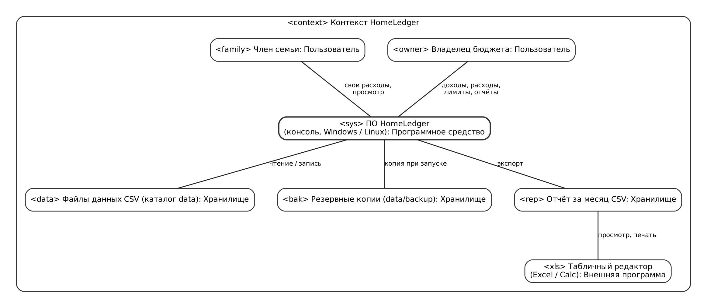
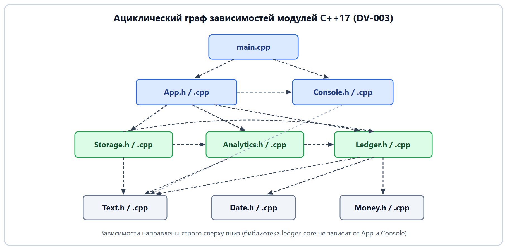

# Описание дизайна программного обеспечения

Для **HomeLedger — Домашняя бухгалтерия**

Версия 1.1 (ЛР № 4 — системные требования и архитектура)

Подготовил: Клещенок Олег Вячеславович, студент гр. 434701

БГУИР, военный факультет, кафедра ЭВМ

2026-11-12

## Оглавление

* [1. Введение](#1-introduction)
* [2. Обзор дизайна](#2-design-overview)
* [3. Проектные представления](#3-design-views)
* [4. Решения](#4-decisions)
* [5. Приложения](#5-appendixes)

## История изменений

| Автор | Дата | Причина изменений | Версия |
|---|---|---|---|
| Клещенок О. В. | 2026-11-05 | Первичная архитектура по SRS v0.2 (ЛР № 4, Раунд 1) | 1.0 |
| Клещенок О. В. | 2026-11-12 | Добавление целей накоплений, регулярных платежей, долгов, быстрого ввода, HTML-дашборда и снимков (ЛР № 4, Раунд 2) | 1.1 |

---

## 1. Введение {#1-introduction}

### 1.1 Назначение документа {#11-document-purpose}

Настоящий документ описания проектирования программного обеспечения (Software Design Description, SDD) фиксирует архитектуру, компонентное разбиение, структуру данных и ключевые алгоритмы системы «HomeLedger — Домашняя бухгалтерия». Документ разработан на основе стандарта IEEE 1016 / ISO/IEC/IEEE 42010:2011 и служит прямым руководством для команды разработчиков (Middle- и Junior-разработчик), а также основой для рецензирования и приёмочного тестирования. Связанные документы: спецификация требований [SRS v0.2](../srs/srs-homeledger.md), записи архитектурных решений [ADR-0001..0005](../adr/) и итерационный план [iterations-and-negotiation.md](../planning/iterations-and-negotiation.md).

### 1.2 Область применения {#12-subject-scope}

Объект проектирования — настольное кроссплатформенное консольное приложение **HomeLedger** на языке C++17 (только стандартная библиотека и системное API консоли Windows/POSIX). Программа решает бизнес-цели БЦ-1…БЦ-5 и системные требования после Раунда 2 переговоров с Заказчиком: оперативный учёт доходов, расходов и переводов между кошельками, контроль месячных лимитов, расчёт статистики (правило 50/30/20, динамика 6 мес., индекс финансового здоровья), управление целями накоплений, регулярными платежами и долгами, а также экспорт отчётов в CSV (Excel) и автономный HTML-дашборд. Вне рамок релиза 1.0 остаются мобильное/веб-приложение, онлайн-синхронизация с банками, мультивалютность и парольная аутентификация (CON-1, CON-5).

### 1.3 Определения, акронимы и сокращения {#13-definitions-acronyms-and-abbreviations}

| Термин | Определение |
|---|---|
| ADR | Architecture Decision Record — запись принятого архитектурного решения в формате MADR 4.0 |
| BYN | Белорусский рубль; единственная расчётная валюта системы (CON-5) |
| CLI | Command Line Interface — текстовый консольный пользовательский интерфейс |
| DTO | Data Transfer Object — структура данных без логики хранения (`Operation`, `SavingsGoal`, `Debt`) |
| SDD | Software Design Document — описание проектирования ПО (IEEE 1016 / ISO 42010) |
| SRS | Software Requirements Specification — спецификация требований к ПО |

### 1.4 Ссылки {#14-references}

1. IEEE Std 1016-2009. Systems Design — Software Design Descriptions (нормативная база шаблона SDD).
2. ISO/IEC/IEEE 42010:2011. Systems and software engineering — Architecture description (точки зрения и представления).
3. SRS HomeLedger v0.2: [docs/srs/srs-homeledger.md](../srs/srs-homeledger.md) (нормативная основа требований).
4. Архитектурные решения MADR 4.0: [docs/adr/](../adr/) (обоснование ключевых решений).
5. План итераций и согласование объёма: [docs/planning/iterations-and-negotiation.md](../planning/iterations-and-negotiation.md).

### 1.5 Обзор документа {#15-document-overview}

Раздел 2 фиксирует заинтересованных лиц (стейкхолдеров), их ключевые задачи и выбранные архитектурные точки зрения. Раздел 3 описывает проектные представления (`DV-001`…`DV-007`) со сквозной трассировкой на требования SRS и ADR. Раздел 4 сводит принятые архитектурные решения. Раздел 5 содержит ссылки на материалы и иллюстрации ЛР № 4.

---

## 2. Обзор дизайна {#2-design-overview}

### 2.1 Задачи стейкхолдеров {#21-stakeholder-concerns}

| Стейкхолдер | Ключевые задачи и риски | Как адресуется в дизайне |
|---|---|---|
| Владелец бюджета (Заказчик) | Быстрый ввод трат (< 15 с), точные расчёты без копеечных погрешностей, контроль перерасхода и накоплений | Быстрый ввод одной строкой (`parseQuickInput`), `Money = long long` (ADR-0002), мгновенная проверка лимита, цели и советы |
| Член семьи | Понятный русскоязычный интерфейс, невозможность случайной потери записей | Подтверждение удаления, стек отмены `Undo`, автобэкап при запуске и именованные снимки (ADR-0003) |
| Разработчик (Middle / Junior) | Чёткие границы модулей для параллельной работы, быстрые автотесты | Статическая библиотека `ledger_core` без консольного ввода-вывода (ADR-0001), цели CMake `HomeLedger` и `ledger_tests` |
| Сопровождающий / GUI-инженер (релиз 2) | Переиспользование всей бизнес-логики под Qt 6 без переписывания | Изоляция классов `Ledger`, `Analytics`, `Storage` в `ledger_core` (REQ-REUSE-001) |

### 2.2 Выбранные точки зрения {#22-selected-viewpoints}

Для описания архитектуры HomeLedger на этапе ЛР № 4 выбраны следующие точки зрения по ISO/IEC/IEEE 42010 (динамические UML-представления взаимодействия и состояний запланированы на ЛР № 5):

1. **Контекстная (`Context`, п. 2.2.1):** определяет внешнее окружение системы (акторы, локальное хранилище CSV, браузер, Excel) (`DV-001`).
2. **Композиционная (`Composition`, п. 2.2.2):** задаёт декомпозицию на статическую библиотеку ядра `ledger_core`, консольный контроллер `App/Console` и набор тестов (`DV-002`).
3. **Зависимостей (`Dependency`, п. 2.2.6):** фиксирует направленный ациклический граф включения заголовочных файлов без циклических ссылок (`DV-003`).
4. **Информационная (`Information`, п. 2.2.7):** определяет 7 табличных сущностей в CSV-хранилище, ключи и правила ссылочной целостности (`DV-004`).
5. **Логическая (`Logical`, п. 2.2.3) и интерфейсная (`Interface`, п. 2.2.8):** фиксирует классы C++17, структуры DTO и публичные контракты модулей (`DV-005`).
6. **Алгоритмическая (`Algorithm`, п. 2.2.10):** описывает детерминированные алгоритмы расчёта индекса финансового здоровья, советов 50/30/20, парсера быстрого ввода и генератора SVG (`DV-006`).
7. **Развёртывания и ресурсов (`Deployment & Resources`, п. 2.2.14–2.2.15):** задаёт статическую сборку единого `.exe` без внешних DLL и управление файлами (`DV-007`).

---

## 3. Проектные представления {#3-design-views}

### DV-001 — Системный контекст HomeLedger
- **Title:** Системный контекст и окружение HomeLedger
- **Viewpoint:** Контекстная (`Context`)
- **Representation:** Система работает полностью автономно на локальном ПК (CON-1, REQ-SEC-001), взаимодействуя с актёрами «Владелец бюджета» и «Член семьи». Внешними файловыми потребителями выступают Excel/Calc (CSV) и веб-браузер (автономный HTML-дашборд). Системный контекст и варианты использования зафиксированы в [SRS v0.2](../srs/srs-homeledger.md).

  
- **More Information:** Связанные требования `REQ-INT-005..007`, `REQ-SEC-001..003`.

### DV-002 — Композиционная архитектура подсистем (`ledger_core` + `App`)
- **Title:** Трёхслойная компонентная архитектура
- **Viewpoint:** Композиционная (`Composition`)
- **Representation:** См. рисунок `sdd-01-architecture.png`. Система разделена на три слоя:
  1. **Слой представления и диалога (`App`, `Console`, `main`)** — отрисовка цветных ANSI-экранов (UTF-8 / `ReadConsoleW`), чтение команд, поддержка стека отмены `undoStack_`, вызов быстрого ввода.
  2. **Слой предметной логики и аналитики (`ledger_core`: `Ledger`, `Analytics`, `Date`, `Money`, `Text`)** — хранение состояния в оперативной памяти, валидация, расчёт балансов, индекса здоровья, прогнозов и советов.
  3. **Слой персистентности и экспорта (`Storage`)** — атомарная запись/чтение 7 CSV-таблиц через `.tmp` + `rename`, автобэкап, именованные снимки с ротацией, экспорт Excel CSV и HTML5+SVG.

  
- **More Information:** Реализует `ADR-0001`, `REQ-REUSE-001`, `REQ-MAINT-001`, `REQ-BUILD-001`.

### DV-003 — Граф зависимостей модулей
- **Title:** Направленные зависимости заголовков C++17
- **Viewpoint:** Зависимостей (`Dependency`)
- **Representation:** См. рисунок `sdd-02-dependencies.png`. Базовый уровень (`Date`, `Money`, `Text`) не зависит от доменных классов. `Ledger` зависит только от `Date`, `Money`, `Text`. `Analytics` зависит от `Ledger` и `Text`. `Storage` зависит от `Ledger`, `Analytics`, `Text`. `App` и `Console` зависят от `ledger_core`, при этом ни один модуль ядра не включает `App.h` или `Console.h` — цикл зависимостей исключён.

  
- **More Information:** Реализует `ADR-0001`, `REQ-COMP-002`.

### DV-004 — Информационная модель данных и схема CSV
- **Title:** Структура постоянных данных и DTO
- **Viewpoint:** Информационная (`Information`)
- **Representation:** См. рисунок `sdd-03-data-model.png`. Постоянное состояние каталога `data/` представлено семью таблицами UTF-8 (разделитель `;`, RFC 4180):
  - `operations.csv`: `id;date;type;amount;category;wallet;to_wallet;comment`
  - `categories.csv`: `name;type;group`
  - `wallets.csv`: `name;initial`
  - `budgets.csv`: `category;limit`
  - `goals.csv`: `id;name;target;saved;deadline;completed`
  - `recurring.csv`: `id;name;type;amount;category;wallet;day;last_ym;active`
  - `debts.csv`: `id;person;direction;amount;repaid;created;due_date;comment`
  Все денежные поля хранятся с двумя знаками в типе `Money` (`long long` копеек, `ADR-0002`).

  
- **More Information:** Реализует `ADR-0002`, `ADR-0003`, `REQ-INT-005`, `REQ-COMP-001`, `REQ-REL-005`.

### DV-005 — Интерфейсы и контракты классов ядра `ledger_core`
- **Title:** Публичное API доменной модели, аналитики и хранилища
- **Viewpoint:** Логическая (`Logical`) и интерфейсная (`Interface`)
- **Representation:**
  - `Ledger`: `validate(op)`, `add(op)`, `update(op)`, `remove(id)`, `between(from, to)`, `search(filter)`, `walletBalance(w)`, `totalBalance()`, `addGoal` / `contributeGoal`, `addRecurring` / `dueRecurring` / `applyRecurring`, `addDebt` / `repayDebt`.
  - `Analytics`: `computeStats`, `monthStats`, `budgetStatuses`, `monthlyDynamics`, `computeFinancialHealth`, `weekdayBreakdown`, `projectGoal`, `parseQuickInput`, `makeAdvice`.
  - `Storage`: `load`, `save`, `backup`, `createNamedBackup`, `listNamedBackups`, `restoreNamedBackup`, `exportMonth`, `exportMonthHtml`.
- **More Information:** Реализует `REQ-FUNC-001..025`.

### DV-006 — Алгоритмы аналитики, быстрого ввода и SVG-визуализации
- **Title:** Детерминированные вычисления и рендеринг отчётов
- **Viewpoint:** Алгоритмическая (`Algorithm`)
- **Representation:**
  1. **Индекс финансового здоровья (`computeFinancialHealth`):** сумма четырёх компонент $S = S_{\text{сбер}} + S_{50/30/20} + S_{\text{лим}} + S_{\text{под}} \in [0; 100]$, где $S_{\text{сбер}} \le 30$, $S_{50/30/20} \le 25$, $S_{\text{лим}} \le 25$, $S_{\text{под}} \le 20$ по 3-месячной подушке безопасности.
  2. **Быстрый ввод (`parseQuickInput`):** разбор префикса (`-`/`+`), суммы (`parseMoney`), каскадный поиск категории (`exact` → `prefix` → `substring` с кириллическим `toLowerUtf8`), откат на «Прочее» с сохранением текста в комментарии.
  3. **Векторный HTML-дашборд (`exportMonthHtml`):** расчёт угловых координат секторов кольцевой диаграммы `<path d="M ... A ...">` и нормирование столбцов 6-месячной гистограммы с экранированием `htmlEscape`.
- **More Information:** Реализует `ADR-0004`, `ADR-0005`, `REQ-FUNC-012-2`, `REQ-FUNC-023`, `REQ-FUNC-024`.

### DV-007 — Развёртывание и управление ресурсами
- **Title:** Автономная сборка и файловая структура
- **Viewpoint:** Развёртывания и ресурсов (`Deployment & Resources`)
- **Representation:** Сборка через CMake 3.16+ (MinGW-w64 с флагом `-static` или MSVC) порождает самодостаточный исполняемый файл `HomeLedger.exe` (~2 МБ), не требующий инсталлятора и внешних библиотек (REQ-INST-001). Рабочие файлы размещаются в каталоге `--data` (по умолчанию `./data`), снимки — в `data/backup/snapshots/` с ротацией не более 10 каталогов.
- **More Information:** Реализует `REQ-INST-001`, `REQ-PORT-001`, `REQ-REL-002..003`.

---

## 4. Решения {#4-decisions}

| ID | Заголовок | Статус | Связанные представления |
|---|---|---|---|
| [ADR-0001](../adr/0001-layered-architecture-ledger-core.md) | Разделение на слои с независимой библиотекой ядра `ledger_core` | accepted | DV-002, DV-003, DV-005 |
| [ADR-0002](../adr/0002-integer-kopeck-money.md) | Представление денежных сумм в целых копейках (`long long`) | accepted | DV-004, DV-006 |
| [ADR-0003](../adr/0003-csv-atomic-storage-and-backups.md) | Локальное CSV-хранилище с атомарной записью и именованными снимками | accepted | DV-004, DV-007 |
| [ADR-0004](../adr/0004-deterministic-advice-and-health-index.md) | Детерминированные правила советов и композитный индекс финансового здоровья | accepted | DV-006 |
| [ADR-0005](../adr/0005-dual-export-csv-and-offline-html-dashboard.md) | Двойной экспорт отчётов — табличный CSV и автономный HTML-дашборд с SVG | accepted | DV-006 |

---

## 5. Приложения {#5-appendixes}

- Спецификация требований SRS v0.2: [docs/srs/srs-homeledger.md](../srs/srs-homeledger.md)
- Приоритизация функционала, переговоры и итерационный план: [docs/planning/iterations-and-negotiation.md](../planning/iterations-and-negotiation.md)
- Протоколы архитектурных решений ADR-0001…0005: [docs/adr/](../adr/)
- Иллюстрации архитектуры и планов ЛР № 4: [docs/sdd/images/](images/), [docs/planning/images/](../planning/images/)
